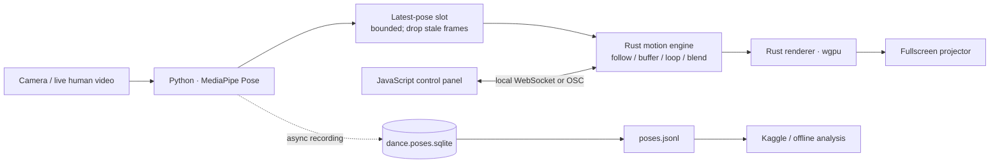

# mp-dance-lora

**Low-latency dance VJ: live human video in, continuous motion and projection out.**

Capture a real person with a camera, extract movement, and project responsive visuals. When the performer stops moving, the system continues dancing by looping, blending, or transforming a buffered motion phrase. The renderer is replaceable; any fullscreen renderer that can drive a projector is acceptable.

## System architecture

Editable diagram sources: [Mermaid source](docs/architecture.mmd) · [PlantUML source](docs/architecture.puml) · [Architecture notes](docs/architecture.md)

The system is split into a **live performance path** and an **offline data path**. Database writes, exports, Kaggle analysis, and model training must never block projector rendering.

## How it works

1. **Capture — camera:** receive raw live video from a person. The input is a live human performance, not only prerecorded VTuber footage.
2. **Pose estimation — Python + MediaPipe:** turn each usable frame into timestamped body landmarks. Keep the input resolution configurable for the 16 GB RAM target.
3. **Latency boundary — latest-pose slot:** send only the newest pose to the motion engine. Use a bounded queue and discard stale frames; an unbounded queue makes latency grow.
4. **Motion continuity — Rust:** follow live movement when reliable movement is present. Maintain a small ring buffer and continue with replay, loop, blend, mirror, or transformation when the performer is still or tracking temporarily fails.
5. **Rendering — Rust + wgpu (candidate):** draw pose lines, silhouettes, repeated figures, trails, and visual effects at a stable frame rate. Keep rendering independent from Python inference.
6. **Controls — JavaScript:** provide a small operator panel for calibration, color, trails, loop behavior, and status. A local WebSocket or OSC link is a transport option; benchmark before locking it in.
7. **Recording and learning — SQLite / JSONL / Kaggle:** record timestamped pose sequences asynchronously, export them for offline analysis, and experiment with motion models separately from the live VJ process.

## Runtime data flow

GitHub renders Mermaid diagrams directly in Markdown; the editable source is also kept in `docs/architecture.mmd`. [GitHub Mermaid documentation](https://docs.github.com/en/get-started/writing-on-github/working-with-advanced-formatting/creating-diagrams). 

## Language responsibilities

| Layer | Language / technology | Responsibility |
|---|---|---|
| Capture and pose | Python + MediaPipe Pose | Camera frames, pose inference, timestamps, quality checks |
| Motion and rendering | Rust; `wgpu` is a candidate | Bounded pose input, continuous motion, trails, real-time fullscreen output |
| Operator UI | JavaScript | Calibration, parameters, start/stop, runtime status |
| Dataset | SQLite + JSONL | Durable local sessions and portable pose sequences |
| Offline experiments | Python / Kaggle notebooks | FPS and quality reports, motion features, training/evaluation |
| Architecture docs | Mermaid (`.mmd`), SVG, PlantUML (`.puml`) | Editable and embedded system diagrams |

These are proposed boundaries, not a claim that the full runtime is already implemented. Keep the first prototype small and benchmark the actual machine before adding complex models.

## Low-latency design rules

- **No unbounded queues.** Prefer the newest pose over a backlog of old poses.
- **Do not block rendering.** Camera capture, inference, database writes, and rendering must not wait on one another.
- **Continue without a live pose.** Use the motion buffer when the person stops, moves out of frame, or tracking is lost.
- **Measure end-to-end latency.** Track capture-to-render delay, displayed FPS, frame-time variance, dropped frames, and memory over a long session.
- **Start with lightweight visuals.** Pose lines, silhouettes, trails, and duplicated motion are the first target; 3D avatars and generative video can come later.
- **Keep training offline.** LoRA or other model training is optional and must not be required for the first live projection loop.

## File formats

- `.mp4` — optional source-video recording
- `.jsonl` — timestamped pose frames for replay and data exchange
- `.sqlite` — local source of truth, e.g. `dance.poses.sqlite`
- `.ipynb` — offline analysis and training experiments
- `.safetensors` — optional model/LoRA weights, not required by the first live VJ
- `.vrma`, `.vmd`, `.fbx` — optional avatar-motion formats, depending on the target runtime
- `.mmd` — editable Mermaid diagram source
- `.svg` — embedded vector architecture diagram
- `.puml` — editable PlantUML diagram source

## Development sequence

1. Show live MediaPipe landmarks fullscreen.
2. Record timestamped landmarks to `dance.poses.sqlite` and export JSONL asynchronously.
3. Add a bounded motion buffer; prove that output continues while the performer is still.
4. Add a Rust renderer and projector output; keep rendering smooth during inference stalls.
5. Add the JavaScript operator controls and calibration.
6. Measure latency, FPS, and memory use on the 16 GB target machine.
7. Add Kaggle analysis and optional motion-model training after the live loop is reliable.

## Related issues

- [Epic #1 — end-to-end capture-to-model pipeline](https://github.com/bonsai/mp-dance-lora/issues/1)
- [Issue #2 — MediaPipe capture to SQLite](https://github.com/bonsai/mp-dance-lora/issues/2)
- [Issue #3 — SQLite/JSONL schema and exporter](https://github.com/bonsai/mp-dance-lora/issues/3)
- [Issue #4 — Kaggle FPS, quality, and motion analysis](https://github.com/bonsai/mp-dance-lora/issues/4)
- [Issue #5 — model target and evaluation](https://github.com/bonsai/mp-dance-lora/issues/5)

## References

- [MediaPipe Pose Landmarker](https://developers.google.com/edge/mediapipe/solutions/vision/pose_landmarker)
- [wgpu](https://wgpu.rs/)
- [GitHub Mermaid diagrams](https://docs.github.com/en/get-started/writing-on-github/working-with-advanced-formatting/creating-diagrams)
