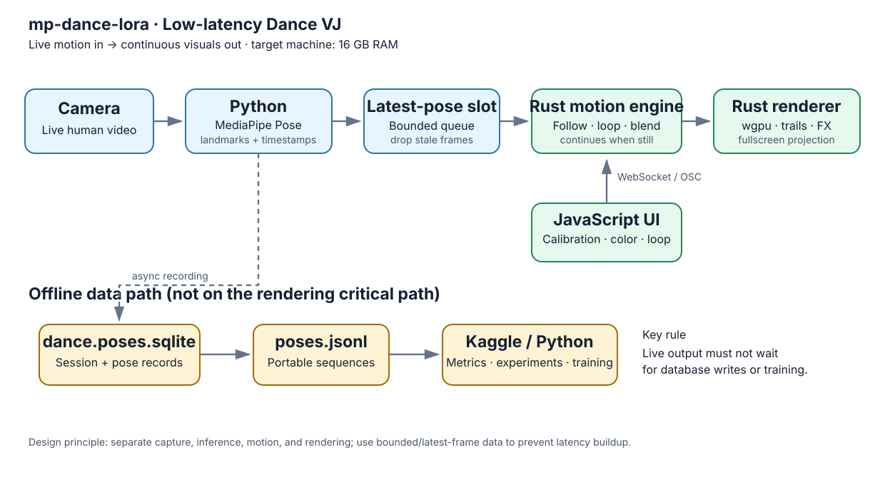
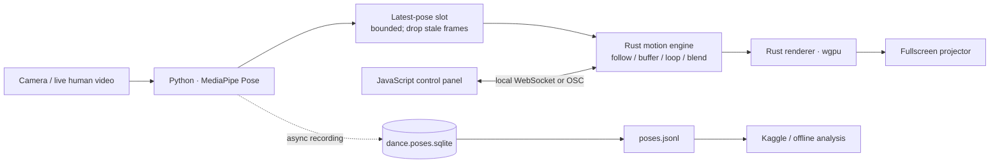

# mp-dance-lora

**Low-latency dance VJ: live human video in, continuous motion and projection out.**

Capture a real person with a camera, extract movement, and project responsive visuals. When the performer stops moving, the system continues dancing by looping, blending, or transforming a buffered motion phrase. The renderer is replaceable; any fullscreen renderer that can drive a projector is acceptable.

## System architecture

Editable diagram sources: [Mermaid source](docs/architecture.mmd) · [PlantUML source](docs/architecture.puml) · [Architecture notes](docs/architecture.md) · [Real-time and learning model](docs/realtime-learning.md)

The system has three coordinated loops: **real-time performance**, **short-term adaptation**, and **background model learning**. Learning can be continuous, but projector output must never wait for training.

## How it works

1. **Capture — camera:** receive raw live video from a person.
2. **Pose estimation — Python + MediaPipe:** turn each usable frame into timestamped body landmarks.
3. **Latency boundary:** send the newest pose to the motion engine using a bounded/latest-value slot; discard stale frames rather than building a backlog.
4. **Motion continuity — Rust:** follow live movement when available. When the performer is still or tracking fails, continue with replay, looping, blending, mirroring, or transformation of buffered motion.
5. **Rendering — Rust + wgpu (candidate):** draw pose lines, silhouettes, repeated figures, trails, and visual effects independently of inference.
6. **Controls — JavaScript:** configure calibration, color, trails, loop behavior, and learning/update policy.
7. **Recording and learning:** append pose records asynchronously to SQLite/JSONL. Use short windows for lightweight adaptation and separate background jobs for model training.

## Real-time vs. learning

"Learn every time and reflect every time" is right as a product experience, but **do not retrain model weights on every frame**.

- **Every frame:** infer pose, choose/transform motion, and update visuals immediately.
- **Every short motion window:** update lightweight features and parameters such as tempo, phrase selection, blending, and trails.
- **Continuously:** record examples asynchronously for future learning.
- **In the background:** train candidate models without blocking projection.
- **After validation:** switch to a candidate at a safe motion boundary; keep rollback to the previous version.

This separates immediate adaptation from expensive model training. See [docs/realtime-learning.md](docs/realtime-learning.md) for the loops, update contract, and validation strategy.

## Runtime data flow

## Language responsibilities

| Layer | Language / technology | Responsibility |
|---|---|---|
| Capture and pose | Python + MediaPipe Pose | Camera frames, pose inference, timestamps, quality checks |
| Motion and rendering | Rust; `wgpu` is a candidate | Bounded pose input, continuous motion, trails, real-time fullscreen output |
| Operator UI | JavaScript | Calibration, parameters, learning mode, model version, status |
| Dataset | SQLite + JSONL | Durable session history and portable pose sequences |
| Learning | Python / Kaggle / background worker | Short-window features, candidate model training and evaluation |
| Architecture docs | Mermaid (`.mmd`), SVG, PlantUML (`.puml`) | Editable and embedded system diagrams |

These are proposed boundaries, not a claim that the full runtime is already implemented. Benchmark the actual machine before adding complex models.

## Low-latency design rules

- No unbounded queues; prefer the newest pose over stale data.
- Never block rendering on inference, database writes, or training.
- Continue output from the motion buffer when no live pose is available.
- Measure capture-to-render latency, FPS, frame-time variance, dropped frames, RAM use, and model-switch time.
- Start with lightweight pose lines, silhouettes, trails, and duplicated motion.
- Keep the active model stable; validate candidate updates and preserve rollback.

## File formats

- `.mp4` — optional source-video recording
- `.jsonl` — timestamped pose frames for replay and data exchange
- `.sqlite` — local source of truth, e.g. `dance.poses.sqlite`
- `.ipynb` — offline analysis and training experiments
- `.safetensors` — optional model/LoRA weights, not required by the first live VJ
- `.vrma`, `.vmd`, `.fbx` — optional avatar-motion formats
- `.mmd` — editable Mermaid diagram source
- `.svg` — embedded vector architecture diagram
- `.puml` — editable PlantUML diagram source

## Development sequence

1. Show live MediaPipe landmarks fullscreen.
2. Record timestamped landmarks asynchronously.
3. Add a bounded motion buffer and prove output continues while the performer is still.
4. Add the Rust renderer and projector output.
5. Add JavaScript controls and short-window adaptation.
6. Measure latency, FPS, and memory on the 16 GB target machine.
7. Add background training, validation, safe model switching, and rollback.

## Related issues

- [Epic #1 — end-to-end capture-to-model pipeline](https://github.com/bonsai/mp-dance-lora/issues/1)
- [Issue #2 — MediaPipe capture to SQLite](https://github.com/bonsai/mp-dance-lora/issues/2)
- [Issue #3 — SQLite/JSONL schema and exporter](https://github.com/bonsai/mp-dance-lora/issues/3)
- [Issue #4 — Kaggle FPS, quality, and motion analysis](https://github.com/bonsai/mp-dance-lora/issues/4)
- [Issue #5 — model target and evaluation](https://github.com/bonsai/mp-dance-lora/issues/5)

## References

- [MediaPipe Pose Landmarker](https://developers.google.com/edge/mediapipe/solutions/vision/pose_landmarker)
- [wgpu](https://wgpu.rs/)
- [GitHub Mermaid diagrams](https://docs.github.com/en/get-started/writing-on-github/working-with-advanced-formatting/creating-diagrams)
