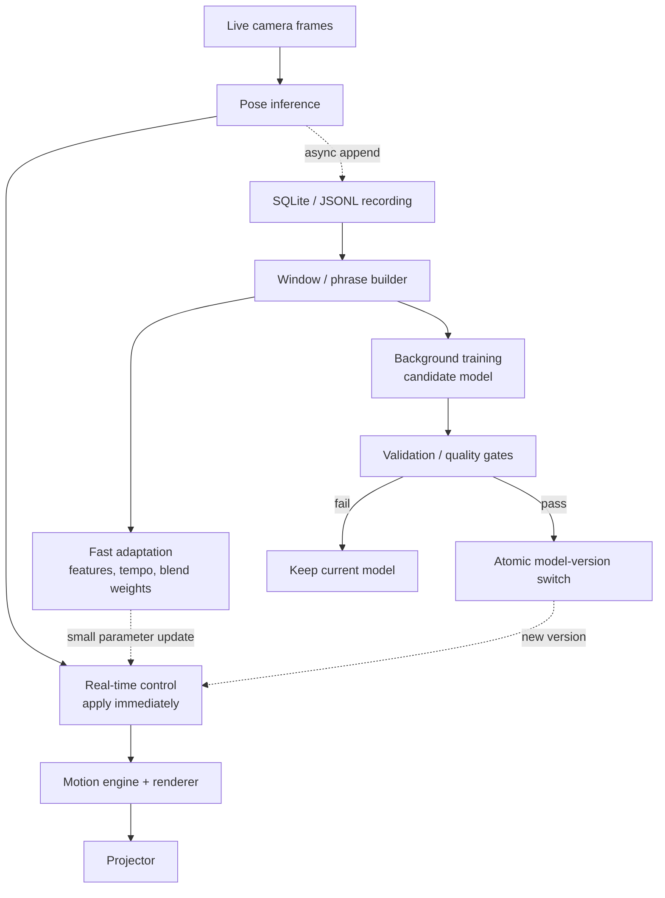

# Real-time playback and continuous learning

## Short answer

"Learn every time and reflect every time" is a useful product goal, but it should not mean retraining the model on every camera frame and swapping weights immediately. That would add unpredictable latency, risk unstable behavior, and compete with rendering for CPU/GPU/RAM.

Use **continuous observation, immediate control updates, background learning, and guarded model promotion**.

## Four different loops

| Loop | Typical trigger | What changes | Must block projection? |
|---|---|---|---|
| Real-time control | Every frame / pose update | Current pose, visual parameters, motion selection | No |
| Short-term adaptation | Each short motion window or detected phrase | Tempo, motion phase, trail amount, blend weights, motion-buffer selection | No |
| Dataset accumulation | Every frame, asynchronously | Timestamped pose records and quality metadata | No |
| Model learning | Scheduled batch, new phrase, or explicit training request | Candidate motion model / model weights | No |

The timing values should be measured and configured on the target 16 GB RAM machine. They are not fixed requirements.

## Recommended loop

## What can be reflected immediately?

These do not require training model weights and are suitable for immediate or short-window adaptation:

- Current pose and body velocity
- Motion phrase selection based on recent movement
- Playback speed, phase, blend amount, mirroring, and loop point
- Trail persistence, color, duplication count, and effect intensity
- Confidence-aware fallback when tracking is weak
- Updating a recent-motion buffer

These are **state/parameter updates**, not necessarily machine learning.

## What should be learned in the background?

Use recorded sequences to improve motion selection or train a pose-sequence model. Run training in a separate worker or offline Kaggle job, with bounded CPU/GPU and memory use. Do not let training take over the render thread.

When a candidate model is ready:

1. Validate output quality, latency, and memory use.
2. Keep the currently active model available as a fallback.
3. Load the candidate without blocking the renderer.
4. Switch model versions at a safe boundary, such as the end of a motion phrase.
5. Roll back if errors, frame time, or output quality regress.

For a future online-learning mode, update a small adapter or policy in the background and promote updates only after checks. Avoid unvalidated per-frame weight changes.

## Suggested runtime boundaries

- **Python:** MediaPipe inference, timestamps, recording, phrase/feature extraction, optional background learner.
- **Rust:** real-time motion state, visual parameter application, renderer, and a stable interface for model/parameter updates.
- **JavaScript:** controls for learning mode, update policy, current model version, and pause/rollback.
- **SQLite / JSONL:** append-only training history with timestamps, schema version, and provenance.
- **Kaggle:** reproducible offline experiments and candidate model training; not part of the live critical path.

## Update contract

Every update sent to the live engine should be small, versioned, and safe to ignore if stale:

- `timestamp` or `sequence_id`
- `model_version` (when model-related)
- `parameter_delta` or a reference to a candidate configuration
- `source` (live control, short-term adaptation, or trained model)
- optional confidence / validation status

Use a bounded queue or latest-value slot for real-time control. Preserve durable training examples in the recording path instead of trying to push every stored frame through the live control channel.

## Measure the result

Track capture-to-projector latency (median and p95), render FPS and frame-time variance, inference duration, dropped frames, RAM use, model-switch duration, and quality before/after each update. A learning update is successful only if it improves behavior without breaking real-time output.

## Decision

**Recommended default:** every frame is observed; live controls reflect immediately; lightweight adaptation updates per motion window; model training runs in the background; validated models are reflected at safe switch points. This gives the experience of "learning continuously" without making projection depend on training speed.
